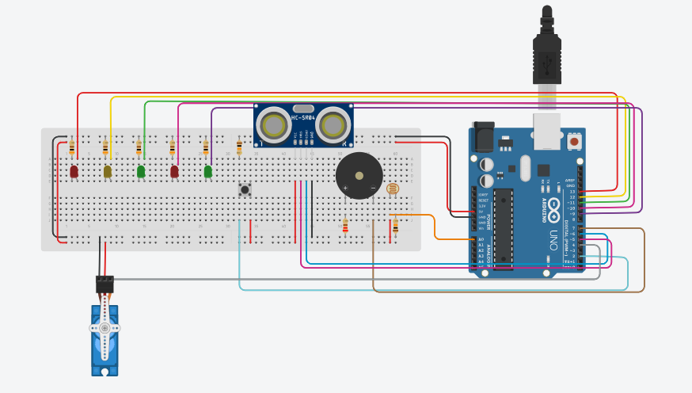

# Semáforo Inteligente com Arduino

## Sobre o projeto

Projeto acadêmico desenvolvido em grupo na disciplina de TI do curso de Ciência da Computação da PUC Minas.

O objetivo é simular um semáforo urbano com controle de travessia de pedestres, detecção de luminosidade e uma cancela automática para veículos.

## Circuito no Tinkercad

## Funcionalidades

- Controle cíclico dos sinais de veículos.
- Solicitação de travessia de pedestres por botão.
- Sinal sonoro durante a travessia.
- Detecção de luminosidade para alternar entre os modos diurno e noturno.
- Pisca do sinal amarelo durante a noite.
- Controle de uma cancela por sensor ultrassônico e micro servo.

## Componentes utilizados

- Arduino
- 2 LEDs vermelhos
- 2 LEDs verdes
- 1 LED amarelo
- 5 resistores de 300 Ω ou 330 Ω
- 1 piezo buzzer
- 1 resistor de 220 Ω
- 1 push-button
- 1 resistor de 10 kΩ para o botão
- 1 LDR (fotorresistor)
- 1 resistor de 10 kΩ para o LDR
- 1 sensor ultrassônico
- 1 micro servo motor
- Protoboard e fios de conexão

## Tecnologias utilizadas

- C/C++ para Arduino
- Arduino IDE
- Biblioteca Servo.h

## Funcionamento

### Semáforo de veículos e pedestres

Durante o dia, o semáforo funciona em ciclos:
- Verde dos veículos: 25 segundos.
- Amarelo dos veículos: 5 segundos.
- Vermelho dos veículos: 15 segundos.

O botão permite solicitar a travessia durante o sinal verde dos veículos. Quando acionado, o sistema antecipa a mudança para o amarelo. Após 5 segundos, o sinal dos veículos fica vermelho e o verde dos pedestres é ativado por 15 segundos.

### Sinal sonoro

Durante os estados de travessia, o buzzer alterna entre frequências de 1.000 Hz e 2.000 Hz, em intervalos de 500 milissegundos.

### Modo noturno

O LDR identifica a luminosidade ambiente. Durante a noite, o LED amarelo dos veículos pisca continuamente, enquanto os demais LEDs e o buzzer ficam desligados. O sensor ultrassônico e a cancela continuam funcionando.

### Cancela automática

O sensor ultrassônico mede a distância de objetos próximos. Quando detecta um objeto a até 30 cm, o servo abre a cancela em 90 graus. Quando o objeto deixa de ser detectado nessa distância, a cancela fecha após 3 segundos.

## Como executar

1. Baixe ou clone este repositório.
2. Abra o arquivo `.ino` na Arduino IDE.
3. Monte o circuito conforme as conexões definidas no código.
4. Conecte a placa Arduino ao computador.
5. Selecione a placa e a porta corretas na IDE.
6. Envie o código para o Arduino e teste o funcionamento.

## Integrantes

- Eloiza Simões Fernandes
- Maria Luiza de Menezes Santos
- Sarah Martins Pedrosa
- Arthur Endy Oliveira Ribeiro
- Caio Anversa Lara

## Autoria

Projeto acadêmico em grupo — Ciência da Computação, PUC Minas.
